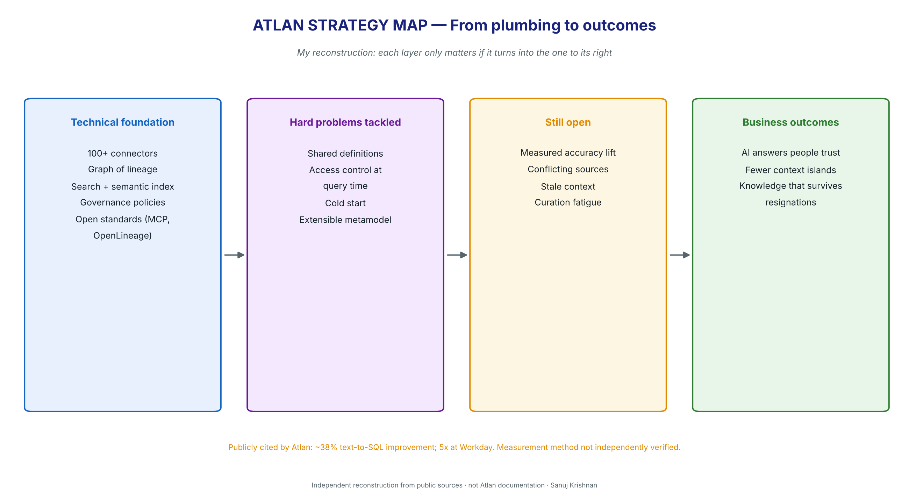
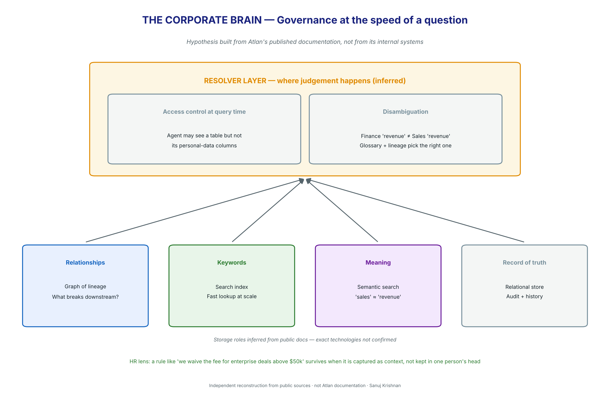
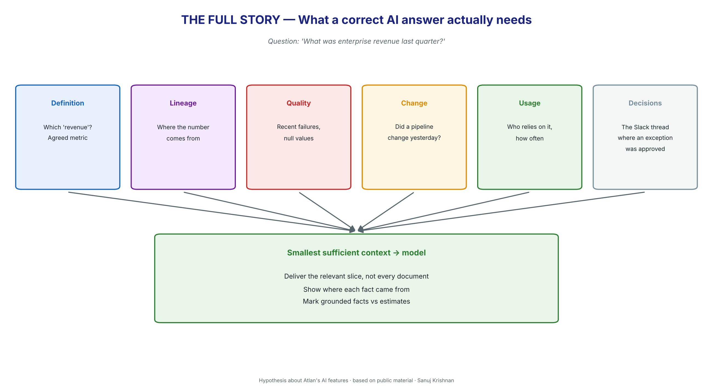
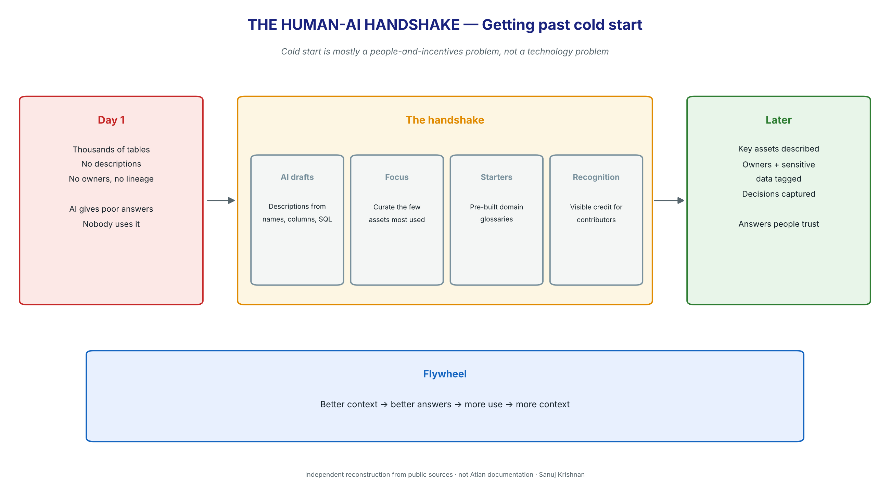
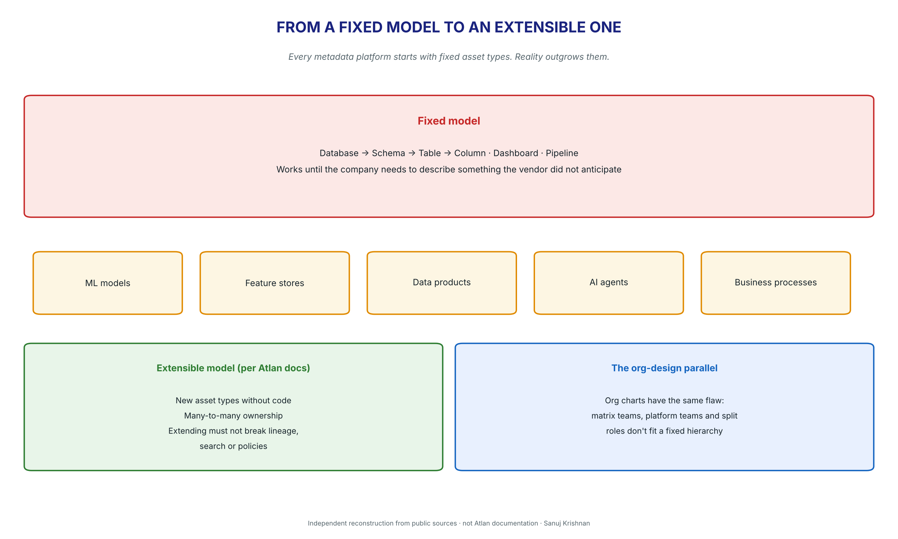

# Atlan: The Architecture of Contextual Intelligence
### Why enterprise AI needs a context layer — a public-signal study

> **Series:** Architecture studies of AI-native companies, written from an org-design lens.
> Part 1: [Ontora](https://github.com/sanoojcools/ontora-architecture-study) · Part 2: Atlan (this study)

> **What this is:** an independent reconstruction built only from public material — Atlan's website, product documentation, published case studies, its open-source repositories, Prukalpa Sankar's essay *"Becoming a Frontier Company,"* and Gartner's November 2025 Magic Quadrant for Metadata Management (G00808349). It is not Atlan documentation, not an affiliation, and not a claim that any inferred layer works exactly as described. Where I am guessing, I say so. Corrections are welcome.

---

### The question that started this

A data catalog used to be a library index: what tables exist, who owns them, where they came from. Useful, rarely exciting.

What caught my attention in Atlan's material was something else. Their product and messaging have moved from *"find your data"* to *"give AI the context it needs to act correctly."* That is a different job. A catalog serves a curious analyst. A context layer serves an AI agent that will confidently answer a CFO's question whether or not it understands what "revenue" means in that company.

Atlan frames this as **P = f(I, C)**: an AI system's performance is a function of its intelligence *and* the context it is given. Models are getting smarter every quarter. Context is the part each company has to build for itself.

As someone who has spent 16 years in HR and organisation design, that framing landed. It is the same problem I have watched in every reorganisation: capable people make bad decisions when the unwritten rules live in someone else's head.

### The big picture

My reconstruction runs from technical foundation → hard problems → remaining challenges → business outcomes. The 100+ connectors matter only when they turn into outcomes such as trustworthy AI answers.

Atlan has publicly cited figures like a 38% improvement in text-to-SQL accuracy and a 5x improvement at Workday after adding metadata context. I have not been able to verify how these were measured. If they come from controlled before-and-after tests against real query logs, they describe a genuine moat. If they are estimates, they are directional at best. That distinction is the single most important open question in this category.

### 1. The corporate brain — governance at the speed of a question

Atlan's documentation describes a platform that combines several kinds of storage and search. My reading of how those pieces likely fit together:

- **Relationships (graph):** *what breaks downstream if I change this table?*
- **Keywords (search index):** fast lookup across millions of assets
- **Meaning (vector/semantic search):** knowing that "sales" and "revenue" may refer to the same thing
- **Record of truth (relational store):** audit trails and change history

On top of storage sits what I call a **resolver layer**: the part that decides what an AI agent is allowed to see and how ambiguous terms are interpreted. Two jobs matter most:

**Access control at query time.** An agent may be allowed to see a customer table but not the personal-data columns inside it. Atlan's published governance features (policies, personas, column-level controls) suggest this check happens before context reaches the model, not after.

**Disambiguation.** When Finance's "revenue" and Sales' "revenue" mean different things, the glossary and lineage tell the system which one the question needs. This is how you avoid the most dangerous AI failure: an answer that is fluent, specific, and wrong.

**Through an HR lens:** this is a knowledge-retention system. When an expert leaves, a rule like *"we waive the fee for enterprise deals above $50k"* survives if it was captured as context rather than kept in someone's memory.

### 2. The full story — why AI answers go wrong

Ask an AI "what was enterprise revenue last quarter?" and a correct answer needs far more than the table. It needs the metric's agreed definition, the table's lineage, recent data-quality failures, whether a pipeline changed yesterday, how heavily the asset is used, and the Slack thread where an exception was approved.

My hypothesis is that Atlan's AI features assemble this "hidden story" before the model answers, and deliver only the relevant slice rather than stuffing every available document into the prompt. Research on long-context models supports the instinct: more context is not automatically better, and models can lose track of what matters in very long prompts.

The test that separates a real system from a demo: does the answer show *where each fact came from* and *how confident the system is*? Grounded facts and estimates should never look the same to an executive.

### 3. The human-AI handshake — solving cold start

Every context layer faces the same Day 1 problem: thousands of tables, no descriptions, no owners, no lineage. The AI has nothing to work with, so it produces poor answers, so nobody uses it, so no context gets added. Many pilots die in this loop.

From Atlan's product material, the way out looks like a division of labour between AI and people:

1. **AI writes the first draft.** Atlan offers AI-generated descriptions from table names, columns and SQL. Humans edit rather than start from blank.
2. **Humans focus where usage is concentrated.** In most data estates, a small share of assets carries most of the queries. Curating those first gives the biggest return.
3. **Starter content.** Pre-built glossaries for common domains reduce the blank-page problem.
4. **Recognition.** Making contributions visible turns tribal knowledge into shared knowledge.

When this works, it becomes a flywheel: better context → better answers → more use → more context. When it fails, it is almost always a people and incentives problem, not a technology problem. That is the part HR leaders should own.

### 4. From a fixed model to an extensible one

Any metadata platform starts with a fixed set of asset types: databases, schemas, tables, columns, dashboards, pipelines. That works until a company needs to describe something the vendor did not anticipate: ML models, feature stores, data products, AI agents, business processes.

Atlan's documentation describes custom metadata and the ability to extend the model with new asset types. The architectural challenge behind that is real:

- **New types without code:** a team defines "ML Model" with its own fields, lineage and permissions.
- **Many-to-many ownership:** one data product serves five business units; one dataset has owners in two functions.
- **Backward compatibility:** extending the model must not break existing lineage, search or policies.

**The organisational parallel** is why this interests me. Org charts have the same flaw. A fixed hierarchy of company → department → team → employee cannot represent a matrix organisation, a platform team serving five products, or a specialist split across three functions. Any system that models how work actually happens, whether data or people, eventually needs a flexible, many-to-many model. The companies that design for that from the start will avoid painful migrations later.

### What this means for each leader

- **CEO:** most AI pilots fail to move the P&L. MIT's 2025 *GenAI Divide* report found the large majority of enterprise generative-AI pilots showed no measurable financial return. Missing context is one of the most fixable causes.
- **CIO:** if every function builds its own AI with its own definitions, you get context islands. A shared context layer, increasingly exposed through open standards such as the Model Context Protocol (MCP), gives every agent the same version of the truth.
- **CTO:** bigger context windows are not a strategy. Delivering the smallest sufficient context is cheaper, faster and more reliable.
- **CHRO:** tacit knowledge walks out the door with every resignation. A context layer turns *"except when…"* rules into an asset the organisation keeps.
- **Investor:** models are becoming commodities. Connectors and storage can be copied. Years of curated, customer-specific context are much harder to replicate.

### Open questions I would ask Atlan

1. **How is accuracy lift measured?** Controlled tests against real query logs, or estimates?
2. **How are conflicting sources handled?** When the glossary says one thing and a Slack thread says another, which wins, and is the conflict shown to the user?
3. **How is context kept fresh?** A definition that was right last year can quietly become wrong. What flags stale context before an agent relies on it?

### Closing

Atlan appears to be building something closer to an institutional memory than a catalog: a governed, multi-store context layer designed for AI agents rather than human browsers. The hard work ahead is less about features and more about trust: proving measured accuracy, handling conflicting truths, and keeping context fresh without exhausting the people who maintain it.

Those are as much organisational challenges as technical ones, which is exactly why I think HR and data leaders should be reading the same architecture diagrams.

---

**Sources:** [atlan.com](https://atlan.com) and Atlan product documentation · Prukalpa Sankar, *"Becoming a Frontier Company"* · Gartner, Magic Quadrant for Metadata Management Solutions, Nov 2025 (G00808349) · [atlanhq on GitHub](https://github.com/atlanhq) · [OpenLineage specification](https://openlineage.io) · MIT NANDA, *The GenAI Divide: State of AI in Business 2025* · [Model Context Protocol](https://modelcontextprotocol.io)

**Method:** Public sources only. No NDA, no insider access, no inspection of Atlan's private systems. Architecture is reconstructed from published documentation, product material and first principles. Figures attributed to Atlan are as publicly cited and have not been independently verified.

**Author:** [Sanuj Krishnan](https://github.com/sanoojcools) · HR and organisation-design leader writing about AI-native companies · Series: [Ontora](https://github.com/sanoojcools/ontora-architecture-study) → Atlan
